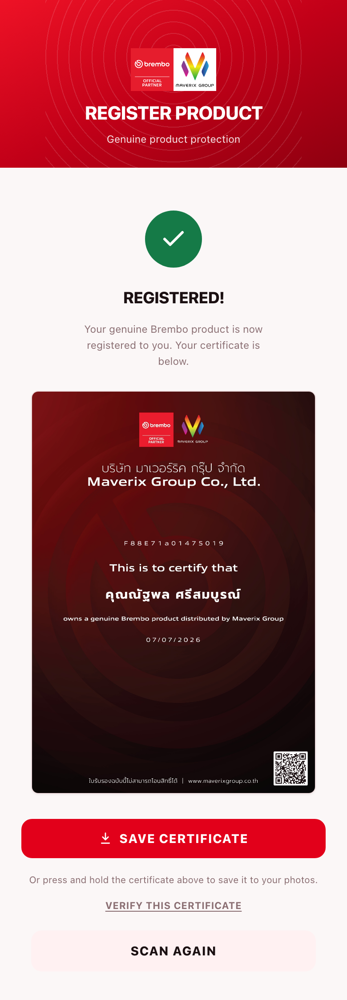
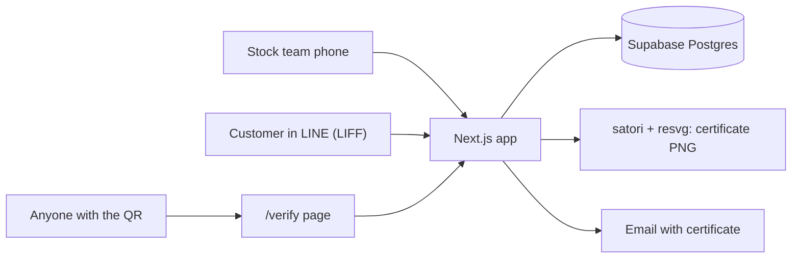

# Brembo product registration

_Registration result with the warranty certificate (test data)._

## The problem

We are an official Brembo distributor. Genuine Brembo parts carry a DataMatrix code with a unique serial. We wanted to record which serial went to which dealer, let the end customer register their part, and give them something to prove it's genuine. Nothing existed for this before.

## What I built

One Next.js app with four parts:

| Part | Who | How they get in |
|---|---|---|
| Scan | Stock team | Staff PIN |
| Manage | Supervisor | Admin PIN |
| Register | Customer, inside LINE (LIFF) | LINE login |
| Verify | Anyone | Public link from the certificate QR |

- Stock team scans DataMatrix or QR codes continuously with the phone camera and tags the dealer. Duplicates are flagged.
- Customer opens it from the LINE OA menu, fills name, phone and email, scans the part. Four outcomes: not verified, already registered by someone else, already yours (shows your certificate again), or registered now.
- The certificate is a PNG built on the server from the official template: name, serial, date, and a QR to the public verify page. Saved in LINE and sent by email.

## Architecture

## Stack

Next.js, TypeScript, Tailwind, Supabase, LINE LIFF, BarcodeDetector with zxing-wasm fallback, satori, resvg, qrcode, nodemailer, DigitalOcean App Platform, Vitest, Playwright.

## Problems worth mentioning

**The scanner didn't read real labels.** The first version used a pure-JS barcode library. It passed tests but couldn't reliably read the small, dense DataMatrix on real Brembo packaging, while a native phone app read it instantly. I switched to the browser's native BarcodeDetector with a zxing-wasm fallback and asked for a high-res camera stream.

**Bugs only a real phone shows.** The camera video element was invisible because of a leftover CSS class, the camera froze after screen lock, and the beep needed a tap before Web Audio would play. Headless tests can't see any of that. Since then I treat a real-device test as part of "done".

**One registration per serial, even under a race.** The unique constraint on the serial in the registrations table is the lock. Two people scanning the same part at once can't both win.

**Certificate rendering on the server.** resvg ships a native binary that Next.js can't bundle, so it has to be marked external. The certificate template also needed exact pixel work for the co-brand logo, checked by rendering the real PNG.

## Result

Live and linked from our LINE OA. The last step before full launch is a field test with the stock team on real stickers. 317 unit tests and 13 e2e tests.
