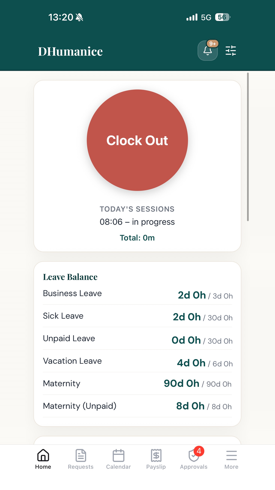
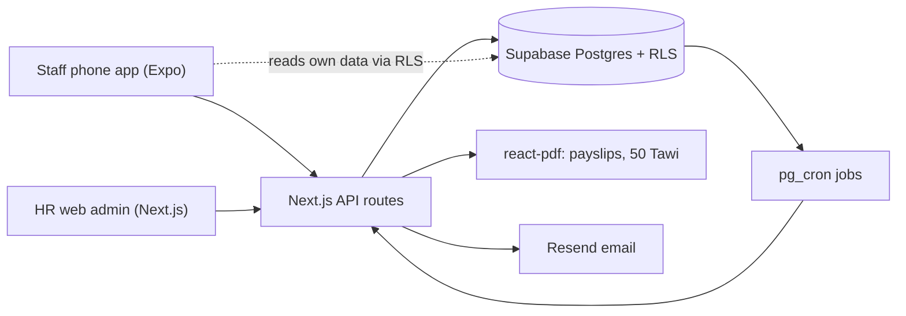

# DHumanice: HR and payroll

_Staff app home screen (demo account)._

## The problem

We paid for ByteHR and only used part of it. HR still did a lot by hand, and Thai payroll details (social security caps, withholding tax, the yearly 50 Tawi certificate) had to come out right every month. The boss wanted it in-house, on a deadline before the ByteHR renewal.

## What I built

Two apps on one database:

- Web admin for HR (Next.js): employees, shifts, leave and OT approval, attendance reports, payroll runs, payslips, tax certificates, Excel exports.
- Mobile app for staff (Expo React Native, iOS and Android): GPS clock in and out against branch locations, leave and OT requests, approvals for managers (with bulk approve), in-app notifications.

Other bits:

- Thai payroll: social security with cap and floor, provident fund, the employee welfare fund, monthly withholding tax with allowances, proration for mid-month joiners.
- Payslip and 50 Tawi withholding-tax certificate PDFs generated with react-pdf, in Thai, on the Revenue Department layout.
- Thai and English UI. About 1,800 strings, with a test that fails if any key is missing in either language.
- Scheduled jobs in Postgres with pg_cron, for example the daily probation-end reminder and opt-in auto clock-out.
- Data migrated from ByteHR: employees, shifts, and payroll history so the first year's tax certificates are correct.

## Architecture

## Stack

Next.js, TypeScript, Tailwind, Expo / React Native, Supabase (Postgres, Auth, RLS, pg_cron), react-pdf, pdf-lib, Resend, DigitalOcean App Platform, Vitest, Playwright, EAS builds.

## Problems worth mentioning

**Thai letters disappearing from the tax certificate.** Random consonants went missing from the 50 Tawi PDF, mostly next to the vowel ำ. I traced it into fontkit (used by react-pdf). The Thai font splits ำ into two glyphs while shaping, fontkit creates one of them with no code points, and then caches that glyph for the life of the font. After the first short Thai run on the page, the text and glyph positions drifted by one, and line breaking dropped the letter next to that vowel. The fix was to split ำ myself before text reaches the renderer, plus a regression test that renders the exact strings that failed.

**PDF generation crashing the server.** HR clicked "download all certificates" and the container ran out of memory and restarted in a loop. The official layout used about 490 MB of heap for 24 certificates on a 512 MB box. I changed it to render one certificate at a time and merge with pdf-lib, which brought it to about 120 MB. Review caught that the first merge version dropped the second page of long certificates, so a page-count check went into the test.

**Clock-in that "hung" but had worked.** A staff member kept tapping clock in and seeing a spinner forever. The server logs showed every tap had landed. The mobile app had no fetch timeout at all, so a lost response meant waiting forever. I added a 15 second timeout, a message saying the punch may have gone through, and a status refresh after any failure. In the same investigation I fixed how shifts that cross midnight are matched.

**Payroll numbers vs the old system.** HR reported a rounding difference. I compared our run against ByteHR's history line by line and found the real issue: the social security wage cap setting was still the old value, not the current legal one. Fixed the setting, the rounding rule, and added a per-line override for edge cases HR needs to handle by hand.

## Result

Live since mid 2026 for the whole company. Web admin on DigitalOcean, mobile app on the App Store and Google Play. ByteHR was not renewed. About 1,400 unit tests plus Playwright e2e tests.
