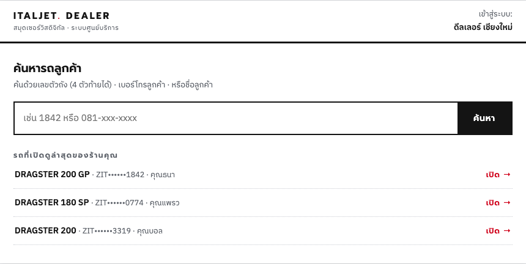
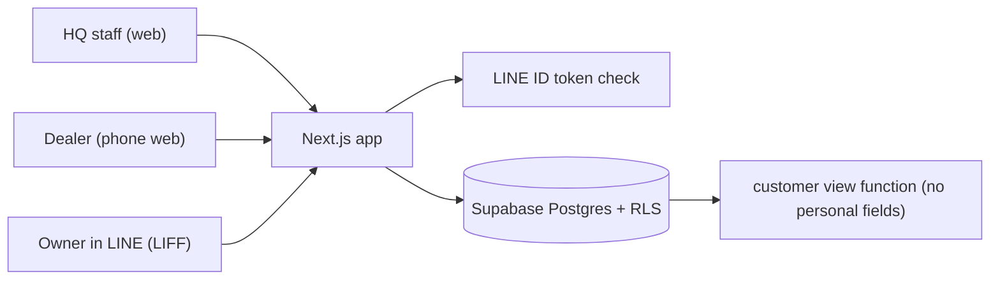

# Italjet digital service book

_Dealer search screen. Design mockup; the app follows this design._

## The problem

Italjet scooter service history lived in paper books and dealer spreadsheets. Our management wanted one place where dealers record each service (mileage, work done, who did it) and the owner can see it on their phone through the Italjet Thailand LINE OA.

## What I built

- HQ portal (desktop first): bikes, owners, dealers, models and colours, search by frame number, phone or name, corrections and voids.
- Dealer portal (mobile first): register a newly sold bike, add service records, search bikes.
- Customer page inside LINE (LIFF), Thai only: link a bike with frame number plus phone, then see the bike card, warranty status and locked service history. Multiple bikes per owner.
- Service records are append-only. Dealers can fix a typo the same day, after that only HQ can void or correct, and the original stays.

## Architecture

## Stack

Next.js, TypeScript, Supabase (Postgres, Auth, RLS), LINE LIFF and LINE Login, DigitalOcean App Platform, Cloudflare DNS, Vitest, Playwright.

## Problems worth mentioning

**Linking a LINE account to a bike safely.** No SMS OTP here (ruled out by the business), so the match rule carries the weight. The server verifies the LINE ID token with LINE, sets a signed httpOnly cookie, then requires frame number (full or last 6) plus the phone recorded at sale. If the last 6 digits match two bikes, it's treated as no match. Attempts are rate limited per LINE user and per IP, and the error never says which part was wrong. If a bike is already linked to another LINE account, it refuses and HQ has an unlink button.

**Customers see less than dealers.** Dealers need the full record (ID number, address, payment). Customers must not get any of that. The customer page reads through one SECURITY DEFINER function that returns a fixed field list, and a test fails if any personal field appears in the response.

**I skipped the "boring" screens and it showed.** For HQ admin I decided at spec time that standard tables and forms needed no mockup. First UAT: no navigation links, a search-only bikes page, no password lifecycle. I ran a full completeness audit (47 findings), wrote a proper app shell plan, and rebuilt. Since then every spec of mine includes navigation, list pages, empty and loading states, and auth flows, admin screens included.

**A modal that closed when you selected text.** Dragging to select text in a form and releasing outside the box closed the modal and lost the input. Backdrop close now needs both pointer down and click on the backdrop.

## Result

Running on a staging deployment with its own domain. Marketing testers are going through the full flow with their own LINE accounts. About 1,200 unit tests plus Playwright e2e.
