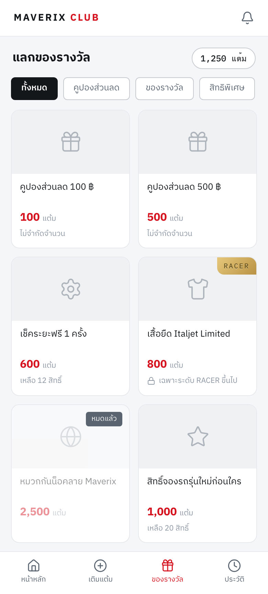
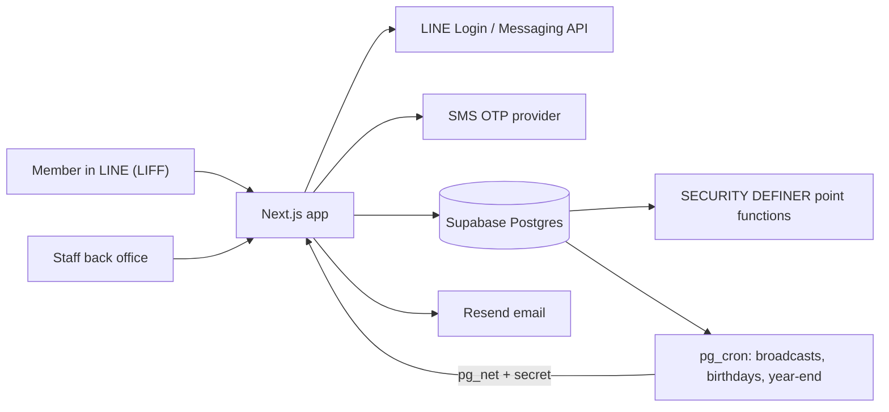

# Maverix Club: LINE loyalty CRM

_Member rewards screen inside LINE (test data)._

## The problem

Our member program ran on EGG Digital's CRM inside LINE, at 360,000 THB/yr. The product was being discontinued anyway. We needed members to keep their place in the program and marketing to keep sending broadcasts, with a fixed launch date.

## What I built

- Member side, inside LINE (LIFF): sign up with phone and SMS OTP, PDPA consent, points balance, tier, coupons, rewards, redeem.
- Points engine: append-only ledger, single-use codes printed on product slips, tiers, birthday points, year-end expiry.
- Back office for staff with roles (owner, campaign, counter): members, manual point adjustments with reason, reward catalogue, code batches with printable QR slips (PDF), redemption queue, broadcasts with segments and a monthly quota, audit log, member import/export.
- Import of about 1,900 members from the EGG export, matched by phone. Returning members get a claim bonus when they link LINE.
- Email alert to marketing when a reward needs shipping.

## Architecture

## Stack

Next.js, TypeScript, Tailwind, Supabase (Postgres, Auth, Storage, pg_cron, pg_net, Vault), LINE LIFF and Messaging API, Thai SMS gateway, Resend, DigitalOcean App Platform, Vitest, Playwright.

## Problems worth mentioning

**Points are money, so no double spend.** Every point change goes through a Postgres function that locks the member row first, then reads the balance, then writes. Codes are single-use at the database level. I have tests that fire an admin adjustment and a redemption at the same time and check the balance never goes negative.

**Moving the broadcast timer off n8n.** Broadcasts first ran from an n8n timer every couple of minutes. That ate our n8n execution quota fast (we hit the monthly cap). I moved it into pg_cron, which calls the app with a secret stored in Vault. Each run is checked on the next tick, and failures email IT and marketing, max once every 6 hours.

**Jobs that were built but never scheduled.** During that move I found the birthday points and year-end expiry functions had been written and tested in an early migration, but nothing ever called them. Scheduled both in pg_cron and added that to the deploy checklist.

**Staff logged out every hour.** The back office had no session refresh, so Supabase sessions just expired. Added a proxy that refreshes the session on admin routes, with a test.

## Result

Live on our LINE Official Account. EGG contract stopped (360,000 THB/yr). About 1,500 automated tests.
