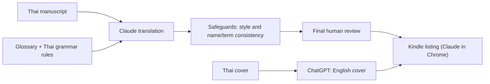

# Thai to English novel translation (side project)

Published on Amazon Kindle under the author's pen name. Titles available on request.

## The problem

A Thai novelist wanted their books in English on Amazon. A raw machine translation reads flat and gets names wrong from one book to the next.

## What I set up

- Claude does the translation, using a glossary and a set of Thai grammar rules I tuned.
- Safeguards so the English doesn't read as AI-written, and so character names and recurring terms stay the same across the whole series.
- ChatGPT adapts each cover to English.
- Claude in Chrome fills in the Kindle listings.
- Every book gets a final human review before it's published.
- Market research with Claude for the English market: the writing style readers expect in this genre, when to release, and how to run the ads.

## Result

11 books published so far.
