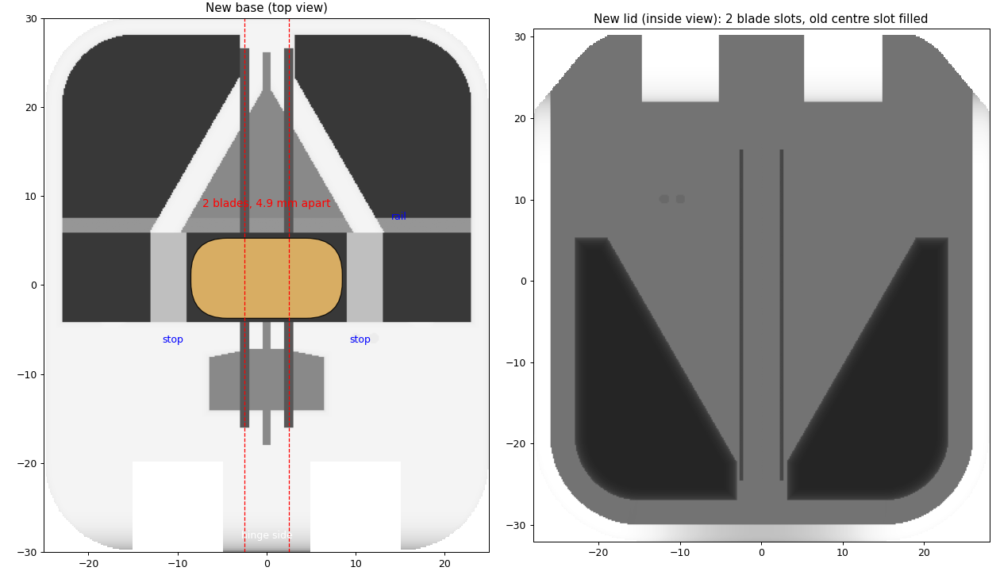

# 3D-printed pill cutter (side project)

_My version: base from the top with the two blade positions and end stops, and the inside of the lid with the two blade slots._

## The problem

A pet needs a third of a tablet every day. Cutting a thick tablet into thirds by hand gives uneven pieces, and for this medication the dose matters.

## What I did

- Started from an open pill-cutter design on MakerWorld (one blade, cuts in half).
- Wrote a Python script with trimesh that rebuilds the base and lid around the real tablet size (17 × 9 × 6.5 mm): a second blade, a deeper channel for the thick tablet, and end stops that centre it so both blades land in the right place.
- The blade gap comes from a parameter, so the script outputs three versions (5.4, 4.9 and 4.4 mm gaps). Print, weigh the pieces, keep the most even one.
- Sliced in Bambu Studio and printed in PETG on a Bambu Lab H2C.

The base design's licence doesn't allow sharing the files, so they aren't published here. Happy to show it in person.

## Stack

Python, trimesh, numpy, STL/3MF, Bambu Studio, Bambu Lab H2C, PETG.
