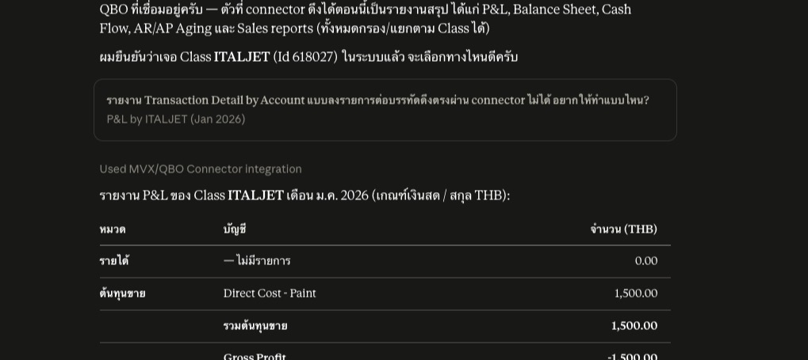
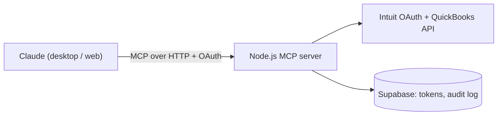

# QuickBooks connector for Claude (MCP)

_Asking Claude for a report in Thai. Cropped before the figures._

## The problem

Our accounting team works in QuickBooks Online. Pulling reports by class (we track each brand as a class), finding miscategorized expenses and fixing them one by one took a lot of clicking and exporting. The team was already using Claude, so I built a connector that lets Claude read and, carefully, write QuickBooks data.

## What I built

A remote MCP server with 32 tools:

- Reads: invoices (also as PDF), estimates, customers, products, accounts, classes, tax codes, sales by brand, P&L (also split by class), general ledger detail.
- Writes always in two steps: a preview stages the change, then `confirm_write` applies it. Covers creating and updating customers, invoices, estimates and products, voids, deletes, and a bulk reclassify (move expenses and bills to another account or class, up to 100 per batch).
- Per-user sign-in with OAuth, so every write in the audit log has a real person's name.
- Audit log in Postgres for every write, including failed ones.

## Architecture

## Stack

TypeScript, Node.js, MCP SDK, Express, OAuth 2.0, QuickBooks Online API, Supabase Postgres, DigitalOcean App Platform, Vitest.

## Problems worth mentioning

**A VAT bug in partial updates.** Updating one line on a bill with a sparse update left the old tax detail frozen, so the VAT no longer matched the amount. Writes now send the full entity without the tax detail so QuickBooks recalculates it. For the bulk reclassify, the first real run was gated to 2 or 3 transactions with a manual VAT check.

**Stale edits.** Preview stores each record's version token. Confirm sends it back, so if someone changed the record in QuickBooks in between, that item fails instead of overwriting their change. In a batch, one stale item doesn't fail the others.

**Multicurrency reports.** Our company file is multicurrency, so QuickBooks renames the amount columns on the general ledger and silently drops the ones you asked for. The first GL pull came back with no money columns at all. I now request both column variants and check the returned column list in live tests.

**All users sharing one rate limit.** Behind the hosting load balancer, every user looked like the same IP, so one person's token refreshes could lock out everyone. Setting the proxy trust correctly fixed it. I also added a short retry grace on refresh token rotation, because a client that lost the response would otherwise be logged out.

## Result

Used by the accounting team for reporting and cleanup. 207 tests. Later retired and fully decommissioned; I archived the repo and removed the hosting, database and connectors.
