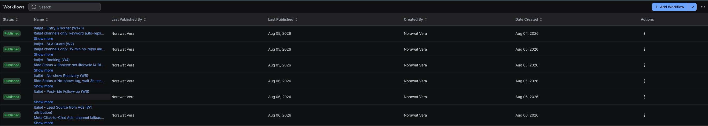
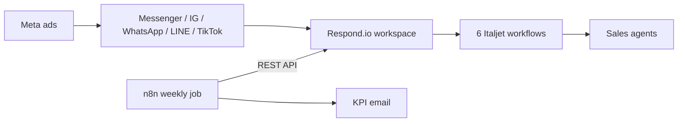

# Italjet chat funnel on Respond.io

_The six live workflows._

## The problem

Italjet Thailand runs Meta ads that open chats on Facebook Messenger, Instagram, WhatsApp, LINE and TikTok. The goal of those chats is a booked Saturday test ride on the Dragster. Chats were answered by hand with no shared rules, and only about 3.3% of chats turned into a booking.

## What I did

This is configuration and integration work, not an app. All in a Respond.io workspace that other brands also share, so I had to stay out of their way.

- Lifecycle stages for the Italjet funnel (engaged, ride booked, rode, negotiation, nurture), custom fields (ride status, ride date, dealer, lead source, colour interest), tags, and 16 reply snippets in Thai and English.
- 6 workflows:

| Workflow | Does |
|---|---|
| Entry and router | Keyword replies for price, trade-in, booking, service |
| Lead source | Tags the contact by which ad channel it came from |
| Response-time guard | During business hours, if a new chat is unanswered after 15 minutes, alerts the supervisor and reassigns if the agent is offline |
| Booking | Moves the contact to "ride booked" and notifies the agent |
| No-show recovery | Sends a follow-up, moves silent contacts to nurture after 3 days |
| Post-ride | Reminds the agent, follows up, moves to negotiation |

- A weekly KPI scorecard in n8n: pulls contacts from the Respond.io API every Friday and emails leads, bookings, rides and wins.
- Wrote a click-by-click build guide and a training doc for the chat agents.

## Architecture

## Problems worth mentioning

**Collisions with workflows other brands already had.** The shared "away message" flow fired on every channel and would greet ad leads we wanted to handle differently. A "recycle inactive leads" flow would have pushed our funnel contacts to cold lead, and it was also wrongly recycling existing customers for every brand. I reviewed all existing workflows first and changed their filters before turning ours on.

**A Thai substring trap.** The price rule matched "ราคา" (price), which is also inside "ตีราคา" (trade-in valuation). Trade-in questions got the price reply. Added an exclusion.

**Triggers that fire on any change.** Respond.io's "contact field updated" trigger fires on any new value, not the one you pick. Each status workflow needed a branch right after the trigger to check the actual value.

**A wrong credential.** The first API calls from n8n failed with an invalid token error. Both the n8n key and the Respond.io token are JWTs, and the n8n one had been pasted into the Respond.io credential. Decoding the token showed it. I also confirmed the API's real filtering and pagination behaviour by testing, since it differed from what the docs suggested.

## Result

All 6 workflows live. Weekly scorecard running. WhatsApp reminder templates and the revival drip are the next step, waiting on Meta template approval.
