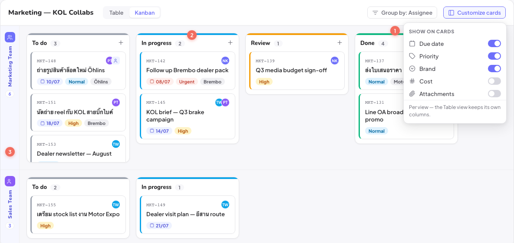
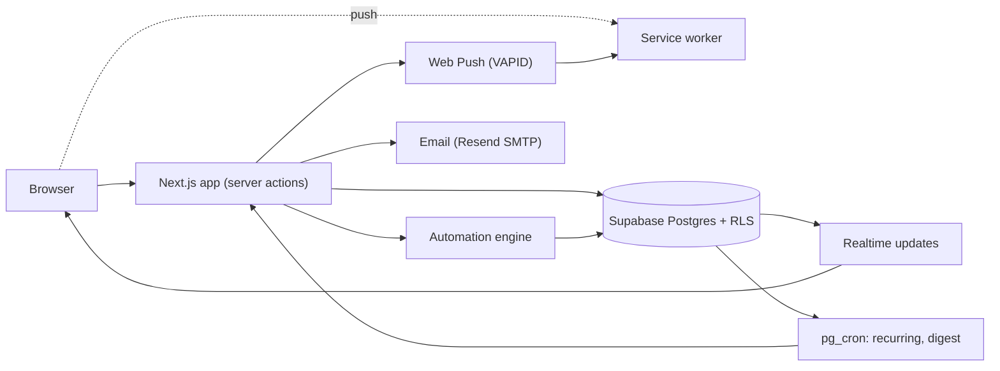

# Tequila: task management

_Kanban board. Design mockup; the app follows this design._

## The problem

I rolled out Monday.com company-wide first, then moved us to ClickUp (about 120,000 THB/yr). Both worked. But we were paying per seat for a big product and only needed part of it, and I wanted our task data and automations in a system we control.

## What I built

A web app modelled on how our teams actually used ClickUp and Monday:

- Departments, boards, groups, tasks and one level of subitems. Custom columns (status, dropdown, date, people, files and more).
- Table and kanban views, saved filters and sorts, shared views.
- Automation rules ("when status changes to X, assign Y / set field / move"), with chaining and a run log. Plus an importer for our old ClickUp automations.
- Recurring tasks (daily to yearly, end conditions, create-new or reset-same).
- Notifications: in-app, a daily email digest, and browser push.
- Roles (owner, admin, member) enforced with row-level security, and groups as assignees.

## Architecture

## Stack

Next.js, TypeScript, Tailwind, shadcn/ui, Supabase (Postgres, Auth, Realtime, Storage, pg_cron, Vault), web-push, DigitalOcean App Platform, Vitest, Playwright, GitHub Actions CI.

## Problems worth mentioning

**Push notifications dead on arrival.** Every test passed but push didn't work in a real browser. The auth middleware matched every path, so the request for `/sw.js` got redirected to the login page. The browser received HTML instead of a service worker and registration failed for everyone. The unit tests mocked the browser and never hit the real middleware. Fixed the matcher and added a test that checks the matcher directly.

**Flicker on bulk edits.** Changing status on several subitems at once made badges jump back and forth before settling. Each write's refresh brought back a half-updated snapshot that overwrote the optimistic UI. I gated the resync on a counter of writes still in flight.

**Tests at this size.** About 3,000 Vitest tests plus Playwright and a CI job that runs the row-level security tests against a real Postgres. I learned to check the runner's exit code and unhandled rejections, not a grep for "passed".

## Result

Running in production and still being rolled out. We keep ClickUp until the move is finished.
