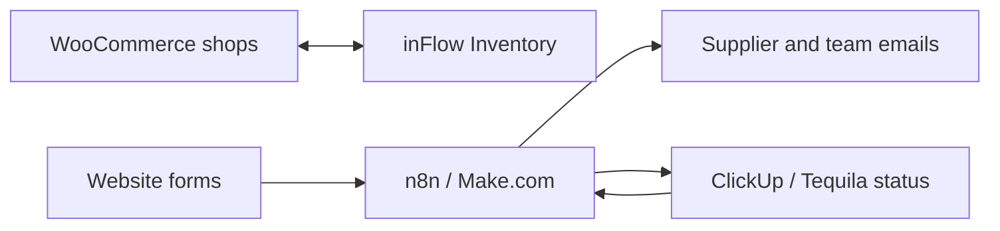

# Websites, shops and automation

No single app here. This is the day-to-day systems work that sits around the apps.

## Websites and shops

- 15 websites on Cloudways, with DNS and caching on Cloudflare.
- 11 WooCommerce shops connected to inFlow Inventory, so stock and orders line up with the warehouse.

## Automations (n8n and Make.com)

| Trigger | What happens |
|---|---|
| ClickUp task status changes | Supplier emails go out: purchase orders, warranty claims, goods-received notes |
| Event sign-up on a website | A task is created in ClickUp for the team |
| Italjet website order | Order processing workflow |
| Italjet test-ride booking form | Booking lands with the sales team |
| Friday 17:00 | Respond.io KPI scorecard email (see [Respond.io case](respondio-italjet.md)) |

My rule now: n8n is for webhooks and daily or weekly glue. Anything that runs every few minutes goes into Postgres with pg_cron, inside the app that owns the data. We hit n8n's monthly execution cap once because of a frequent timer, which is why the CRM broadcasts moved (see [Maverix Club CRM](maverix-club-crm.md)).

## Task tool rollouts

I rolled out Monday.com to the whole company, then moved us to ClickUp, then replaced ClickUp with our own [Tequila](tequila.md).

## AI sales chatbot pilot (supervised)

I supervised a developer who built a pilot AI sales chatbot in n8n. It used OpenAI, Pinecone RAG over our product documents, live stock and sales orders from inFlow, and could read payment slips. We judged it with scored test runs. I ran the project, the developer did the build.
