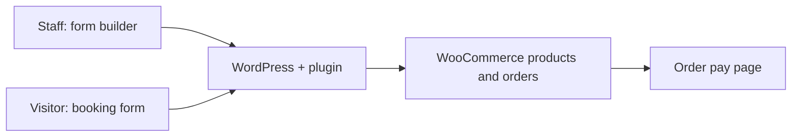

# WooCommerce event booking plugin

## The problem

Italjet runs rider events where people book a room, add companions (adults, kids) and choose event t-shirts, some free and some paid. The old WordPress plugin was hard-coded. Changing rooms, prices or rules meant editing code.

## What I built

A PHP WooCommerce plugin with a shortcode booking form, Thai and English.

- An admin builder: staff set up room cards, occupancy slots (main guest, extra adult, child), which WooCommerce product or variation each slot maps to, free or paid shirt add-ons, notes.
- The builder blocks or warns on bad configs, for example a room capacity too small for its slots, or a fixed price on a variable product.
- Guest checkout with name, phone and email only. The order goes straight to the WooCommerce pay page. If the customer is logged in, the order links to their account.
- Companion counts are capped on the server, not trusted from the form.

## Architecture

## Stack

PHP, WordPress, WooCommerce, JavaScript, PHPUnit (74 tests), Playwright for visual checks, Cloudways with Varnish.

## Problems worth mentioning

**Orders blocked by the firewall.** Some bookings got a 403. The hosting's ModSecurity rules didn't like the order payload when a guest chose "no shirt", because the form sent empty companion arrays. Cleaning the payload fixed it.

**"Mobile bugs" that weren't mobile.** Two bugs reported from the boss's phone turned out to be a builder misconfiguration and a stale Varnish cache. Incognito only skips the browser cache, not the server one. A third report was real: the free-shirt dropdown showed blank for every new visitor because the script set a value with no matching option. Fixed with a proper placeholder.

**Same version, different zip.** A zip rebuilt after a code change but with the same version number doesn't upgrade cleanly in WordPress. Now every rebuild bumps the version.

## Result

Delivered as v2.3.1 for the Italjet event site. Staff set up events in the builder, with Thai setup guides I wrote for them.
